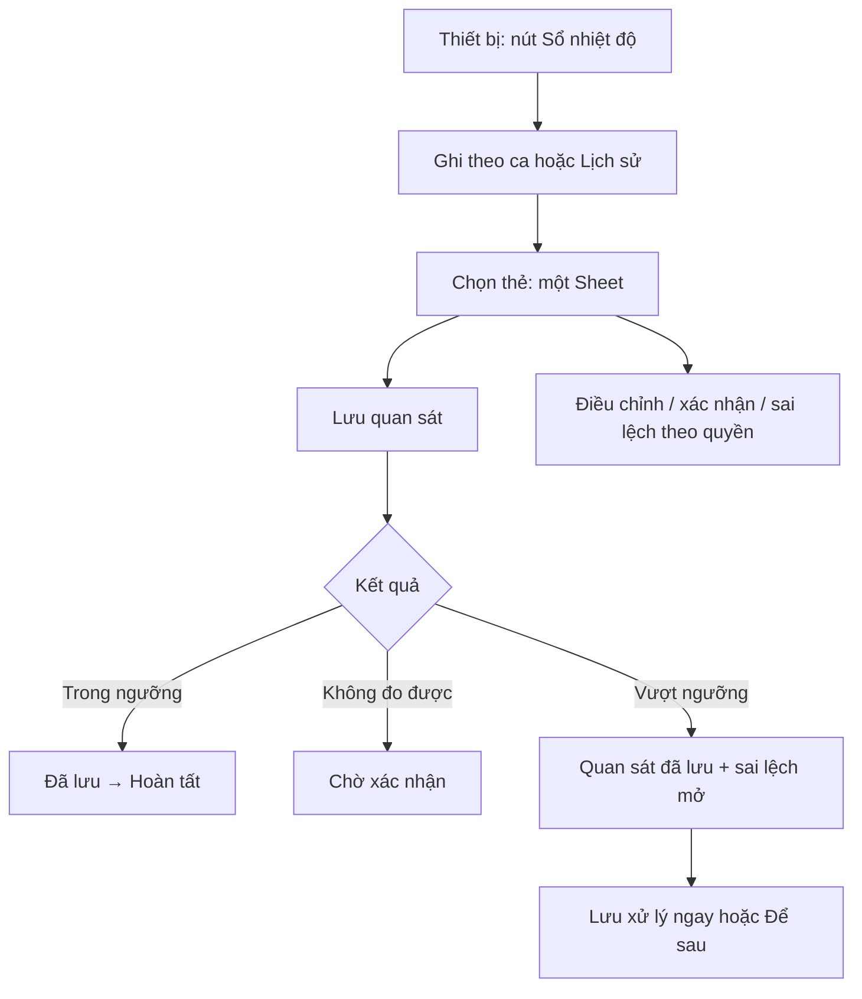

# TM-07 layout proposal

Status: **PROPOSED — awaiting owner layout approval**. Q1–Q9 shared understanding
is confirmed. This document illustrates the approved behavior; the canonical
business contract remains `temperature-monitoring-domain-contract.md`. No runtime
UI/SQL implementation is authorized by this proposal.

## Tóm tắt để duyệt bố cục

1. Mobile có nút **Sổ nhiệt độ** rộng toàn hàng ngay đầu trang Thiết bị; người có
   role `user` cũng thấy và dùng được. Hiện ứng dụng không có menu hamburger
   mobile; giữ nguyên thanh điều hướng dưới và thêm mục sidebar trên desktop.
2. Hai tab **Ghi theo ca** và **Lịch sử** độc lập; lịch sử mặc định 30 ngày,
   chọn nhanh 7/30/90 ngày và luôn hiển thị khoảng đang xem.
3. Chạm thẻ thiết bị để mở một sheet: dưới màn hình trên mobile, bên phải trên
   desktop. Nhập và lưu số đo trong sheet; bất thường đã lưu chuyển sang phần
   xử lý ngay hoặc **Để sau**, không mất số đo.
4. Xem/đề xuất điều chỉnh, xác nhận và xử lý sai lệch trong cùng sheet theo quyền;
   cấu hình nhiệt độ tối thiểu nằm trong hồ sơ thiết bị dành cho quản lý.
5. Chỉ ghép component hiện có, giữ giao diện ứng dụng; ưu tiên màn hình 320/375 px,
   nút chính cao ít nhất 44 px, cuộn được khi mở bàn phím. Bố cục này đang chờ
   duyệt; chưa triển khai frontend hoặc SQL.

## 1. Reach the workspace on mobile

- Desktop: add `Sổ nhiệt độ` to existing `APP_NAV_ITEMS`
  (`src/components/app-navigation.tsx:39`), subject to existing route-access rules.
- Mobile: show a prominent existing `Button` + Next `Link`, labelled
  **Sổ nhiệt độ**, directly above `EquipmentToolbar` in
  `src/app/(app)/equipment/_components/EquipmentPageClient.tsx:254`. Full width at
  320/375px, at least 44 px high; available to role `user` independently of
  `canCreateEquipment`. Existing footer **Thiết bị** → this visible button → sổ.
- Do not rely on a mobile hamburger: current `AppLayoutShell.tsx:183` hides the
  sidebar until `lg`, and its menu toggle at 222 is `hidden lg:flex`. There is no
  mobile navigation sheet today. No new hamburger or fixed-footer change.
- Use approved `/temperature-monitoring` destination and existing authenticated
  layout/route-access boundary. Carry the current explicit facility/equipment
  selection only when present and valid; server scope remains authoritative.
  Existing router/search-param conventions suffice; no new URL-state framework.

```text
Equipment · 320/375px
┌──────────────────────────────┐
│ [ Sổ nhiệt độ             → ]│ ← visible full-width Button
│ Danh mục thiết bị             │
│ [Tìm thiết bị…] [Bộ lọc…]     │
│ Existing equipment cards…    │
└──────────────────────────────┘
 Existing fixed footer unchanged
```

## 2. One responsive workspace, two contexts

Compose existing `Tabs`, `ListFilterSearchCard`, `MobileCompactCard`, `Badge`,
`Alert`, `Button`, `Input`, `Select`, `Textarea`, `Form`/labels and pagination
buttons directly in the necessary page integration. Do not create temperature UI
components, copied card variants or a new component library. Reuse app tokens,
fonts and spacing; no redesign or new animation system.

```text
Sổ nhiệt độ · 320/375px
┌──────────────────────────────┐
│ Sổ nhiệt độ                   │
│ Đơn vị / khoa hiện tại         │
│ [ Ghi theo ca ][ Lịch sử ]     │ ← two equal-width Tabs
│ Ngày bắt đầu ca               │
│ [18/10/2026] [Sáng        ▾]   │
│ [Thiết bị: Tất cả         ▾]  │
│ [Trạng thái: Tất cả       ▾]  │
│ Đang xem18/10 · Asia/Ho_Chi…   │
│ Ghi thủ công phản ánh thời    │
│ điểm đo, không liên tục.      │
│ ┌ Tủ lạnh vaccine · TL-001 ┐ │
│ │ Chưa ghi · Sáng          │ │
│ │ Ngưỡng2–8°C · Nhập tay   │ │
│ │ [Ghi số đo            ] │ │
│ └─────────────────────────┘ │
│ [Tải thêm]                   │
└──────────────────────────────┘
```

- `Ghi theo ca`: selected monitoring date + shift, default to the current effective
  shift using server time and returned schedule/timezone. Before dawn, an active
  overnight shift uses yesterday's start date. If heterogeneous effective
  schedules make one current shift ambiguous, require explicit selection using
  the same visible Select; never guess from browser timezone or hardcoded hours.
- `Lịch sử`: independent default 30-day window with visible start/end, 7/30/90
  preset buttons and custom dates <=90. Existing Select switches **Ô đo** /
  **Sai lệch** so lifecycle filters never become slot states. All filtering and
  cursor pagination are server-side. Switching tab preserves each context's filters.
- History quick links: **Chờ xác nhận** opens slot review filter; **Sai lệch mở**
  opens deviation filter. Counts come from scoped server totals, never current
  page length. Reuse existing notification badge/bell links for these two queues
  when the scoped backend contract is approved; no separate notification screen.
- Cards show equipment code/name, selected slot, one of four slot states,
  snapshot limits/method, effective numeric value or explicit unable reason.
  Review-pending and out-of-range indicators can coexist. A deviation's state
  and severity have their own labelled line. Current policy never replaces a
  historical snapshot. **Hồ sơ thiết bị** uses existing equipment highlight URL.
- At >= 768 px filters flow into existing flexible rows and cards may use two
  columns; at >= 1024 px retain the app sidebar and same card/forms. No separate
  desktop dashboard or bespoke table. All labels remain visible at 320 px.

## 3. One selected-device sheet; no nested overlays

Use existing `SideSheetShell` with `side="bottom"` below 768 px and `side="right"`
above, title/description, scrollable body and footer slots. It already composes
Radix Sheet; use its `onCloseAutoFocus` to restore the exact trigger. The existing
`MobileBottomSheet` is an alternative already surveyed, but do not mount both.
The selected shell is `SideSheetShell` for one shared responsive form composition.

```text
Selected equipment sheet · mobile
┌──────────────────────────────┐
│ TL-001 · Tủ lạnh          [×]│
│ Sáng ·18/10 · Ngưỡng2–8°C    │
│ Đọc nhiệt kế và nhập tay     │
│ [Số đo][Không đo được]        │
│ Nhiệt độ (°C)                │
│ [  5.2                     ] │
│ Thời điểm đo thực tế          │
│ [18/10/2026 08:15           ] │
│ Ghi chú [                  ] │
│ Inline validation / feedback │ ← body scrolls with keyboard
│                              │
│ [Hủy]       [Lưu số đo]       │ ← reachable footer inside sheet
└──────────────────────────────┘
```

- Normal entry: tap **Ghi số đo**, type value, save in the same sheet. Actual time
  is visibly prefilled from current server time only for a current slot; prior
  shifts require explicit actual time, within `[slot_start,slot_end)`. Separate
  server entry time is read-only after save. No rounding; [-200,300] with <=1
  decimal, or unable reason, never both. Negative input remains possible on mobile
  (do not depend on a decimal keyboard having a minus key).
- Saved normal: show **Đã lưu** with effective value/time, then close on
  **Hoàn tất**, returning focus to the card. Do not auto-save the next equipment
  or turn entry into a batch. Card refresh preserves list position/filter.
- Saved breach: keep sheet open; show **Đã lưu số đo — cần xử lý sai lệch**,
  review-pending indicator and separate case severity/status. Replace the entry
  controls with immediate-action Textarea and **Lưu xử lý** / **Để sau**. A failed
  action preserves the saved observation and entered action text, with retry.
  **Để sau** keeps the case open; closure guard remains server-enforced.
- Unable: swap value field for required free-text reason. Saved result clearly
  says **Không đo được · Chờ xác nhận**, never zero/in-range.
- Duplicate/stale: show authoritative existing/revised result with an inline
  conflict Alert. Keep unsent text; offer **Xem bản ghi hiện tại** and permitted
  **Đề xuất điều chỉnh**, never overwrite/retry a review decision automatically.



## 4. Review and deviation without extra screens

- Saved card → **Xem / điều chỉnh** opens the same selected-device sheet in
  read mode: original versus effective value/reason, actual/entry times, snapshot
  and review status. Writers can choose **Đề xuất điều chỉnh** with mandatory
  rationale; one pending proposal is visible, not a second editable original.
- Independent manager sees **Xác nhận**, or **Duyệt / Từ chối điều chỉnh**, and
  **Mở lại** only when valid. Each uses the existing Select/Textarea/Button form
  area for mandatory reason, no secondary modal. Explain self-review exclusion
  when the manager is also operator/proposer; server enforces it.
- A separate **Sai lệch** section in the same sheet shows action/cause/evidence,
  owner/deadline/severity and status. Writers can update actions and advance to
  processing/awaiting verification. Managers additionally assign/change severity,
  verify/close/cancel/link an existing same-equipment repair. Reuse one action
  Select with only available operations and corresponding existing form fields,
  rather than rendering every form simultaneously. Required reasons/verification
  are explicit; selecting an action does not submit it. Self-verification is allowed.
- Audit details load lazily into an existing ScrollArea/section, bounded with
  **Tải thêm**; no mixing with Equipment lifecycle history. Only one active sheet,
  with existing overlay-action transition when leaving an originating menu.

## 5. Equipment profile configuration

Extend existing `EquipmentDetailConfigTab.tsx` (100 lines at base) with a clearly
separated **Theo dõi nhiệt độ** section using existing primitives; keep its current
accessories content. All authorized readers see current enabled/limits/method /
responsibility summary and **Mở sổ nhiệt độ**. Managers see **Cấu hình theo dõi**,
expanding the form in this tab, not a nested dialog.

Form: monitoring enabled, lower/upper °C, existing schedule, primary/substitutes,
effective interval and mandatory change reason. Preselect approved manual method;
display timezone, without a new timezone-management UI. Real scoped catalogs/staff
populate choices. Missing catalog/staff data blocks saving with explanatory
retry/setup feedback; no fixture IDs or uncontrolled free-text user IDs.

## 6. Responsive and state acceptance

| Case        | Concrete requirement                                                                                                                                                                                                                  |
| ----------- | ------------------------------------------------------------------------------------------------------------------------------------------------------------------------------------------------------------------------------------- |
| 320/375px   | One column, min-width: 0, full-width primary entry/save, visible labels, >= 44 px important targets, wrapping long equipment names; no page horizontal scroll.                                                                        |
| Keyboard    | Sheet sized to available dynamic viewport with bounded scrolling body; field and save footer reachable after keyboard opens; safe-area spacing. Validate decimal/minus and datetime controls on a real mobile browser when available. |
| Focus       | Sheet title/description, labelled fields, visible focus, `aria-invalid`/error association; focus first invalid field; status live region after save; restore original trigger, or list heading if card disappears due to filter.      |
| Close       | Explicit close/Cancel and Escape/backdrop follow the same dirty-input check inside the current surface; no second modal. Pending save cannot be dismissed into an ambiguous result.                                                   |
| Loading     | Skeleton list, labelled selected-record loading, disable affected save only; no actionable rows from previous scope/filter.                                                                                                           |
| Error       | Inline scoped retry; preserve unsent form values; state observation success separately from action failure; no raw SQL error display.                                                                                                 |
| Empty       | Distinguish no monitored equipment/no eligible slots/no matching filter/no pending work; manager profile-configuration link where permitted, never enable monitoring silently.                                                        |
| Permissions | Small-width role `user` entry is visible/clickable, and create/amendment actions remain available in exact server scope; read-only sessions see data without write controls.                                                          |

Implementation must fit necessary page/integration files below 450 lines using
existing components. Data/mutations/validation may use minimal non-UI hooks after
semantic reuse search; no JSX helper module or hidden new domain component to
evade this rule. If a readable safe composition cannot fit, surface the exact file
and responsibilities before coding. Workspace/catalog/time-validation/notification
RPC gaps remain separately scoped forward migrations after lead approval; original
11 migrations/inventory entries remain unchanged. No chart/export/dependency work.
